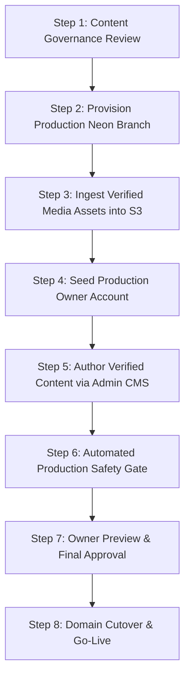

# Sidd.Whizz V1 — Final Content Migration Protocol

**Document Version:** 1.0.0  
**Execution Stage:** Final Phase (Phase 7 — Pre-Launch)  
**Prerequisite:** Full verification of all Phase 0 through Phase 6 technical milestones using synthetic demo data.  
**Audience:** Repository Owner, Technical Lead, and Deployment Operator  

---

## 1. Overview & Objective

This document defines the formal, auditable procedure for replacing all synthetic development fixtures and demo database records with verified, owner-approved content immediately prior to production launch.

Under no circumstances will demo data be migrated or permitted to leak into the production environment.

---

## 2. Owner Content Checklist (Required Deliverables)

Before executing content migration, the repository owner must provide the following verified deliverables:

### 2.1 Identity & Brand Assets
- [ ] High-resolution brand wordmark/logo (SVG or vector-rendered PNG).
- [ ] Official favicon and web clip icons (16x16, 32x32, 180x180, 512x512).
- [ ] Master portrait photography: Minimum 3 high-resolution, professionally color-graded images (Hero landscape, About portrait, Media Kit portrait).

### 2.2 Biographical & Positioning Copy
- [ ] Concise hero tagline and positioning statement (verified 1-sentence value proposition).
- [ ] Short biography for cards, metadata, and preview snippets (approx. 50 words).
- [ ] Comprehensive long biography for the About page and downloadable Media Kit (approx. 250–400 words).
- [ ] Verified hosting milestones and career chronology (dates, locations, and verifiable event formats).

### 2.3 Services & Packages
- [ ] Complete list of official service offerings (e.g. Keynote Conference Emcee, Corporate Awards Host, Panel Moderator).
- [ ] Standard service inclusions, stage requirements, and scope limits.
- [ ] Pricing strategy decision: public fee bands or "Custom Quote upon Enquiry" (default).

### 2.4 Verified Event Portfolio & Case Studies
- [ ] Minimum 4 to 8 verified past events where Siddharth Maurya hosted.
- [ ] Written verification of permitted client names and public event titles (ensuring non-disclosure agreements are respected).
- [ ] Per event: event type, date (YYYY-MM-DD), city, public venue name, organizer brief, hosting approach, audience size, and verified outcome.
- [ ] Permission-cleared event photographs for case study galleries.

### 2.5 Media Clearances & Testimonials
- [ ] Written consent and attribution clearance for every published testimonial quote (full name, title, company, event association).
- [ ] Rights confirmation for all gallery images (confirming ownership or licensed distribution rights).
- [ ] YouTube or Vimeo embed IDs for official showreels (confirming no third-party copyright claims).

### 2.6 Communications, Legal & Operational Configuration
- [ ] Official notification recipient email address (`BOOKING_NOTIFICATION_EMAIL`).
- [ ] Verified sending domain configured and authenticated in Resend (`EMAIL_FROM`).
- [ ] Approved public contact details (business email, public telephone/WhatsApp if desired, official LinkedIn/Instagram handles).
- [ ] Legal counsel approved Privacy Policy and Terms of Service copy.
- [ ] Production custom domain (`siddwhizz.com` or chosen alternative) configured in DNS.

---

## 3. Migration Execution Protocol

The migration from synthetic demo data to real owner content follows an 8-step gated workflow:



### Step 1: Content Governance Review
The technical lead and owner audit the submitted materials against `docs/15_CONTENT_GOVERNANCE.md`:
- Verify zero fabricated statistics, celebrity links, or unauthorized brand logos.
- Verify written permissions are logged in the project governance registry for every testimonial and event photograph.

### Step 2: Provision Production Neon Database & Storage Buckets
1. Ensure the production database branch in Neon (`siddwhizz-prod-main`) is completely clean of development test records.
2. Ensure the production object storage buckets (`siddwhizz-public-prod` and `siddwhizz-private-prod`) are created with appropriate access policies (`public_read` on public bucket; private on private bucket).
3. Set production environment variables in Vercel:
   - `DEMO_MODE=false`
   - `DATABASE_URL` (points to production pooled endpoint)
   - `DIRECT_URL` (points to production direct endpoint)
   - `NEON_STORAGE_BUCKET_PUBLIC=siddwhizz-public-prod`
   - `NEON_STORAGE_BUCKET_PRIVATE=siddwhizz-private-prod`

### Step 3: Ingest Verified Media Assets
1. Upload verified high-resolution photographs to `siddwhizz-public-prod` using the secure Admin Media Manager.
2. Provide descriptive, accessible alt text and photographer credits.
3. Mark rights status as `'approved'`.

### Step 4: Seed Production Owner Account
1. Execute the secure owner provisioning script in the production environment:
   ```bash
   npm run seed:owner
   ```
2. Verify owner account credentials, log in to `/admin`, and ensure multi-factor authentication / secure session cookies are active.

### Step 5: Author Verified Content via Admin CMS
Rather than running unverified raw SQL scripts against production, author content directly through the validated Admin CMS:
1. Populate **Profile & About** settings.
2. Add official **Services**.
3. Create verified **Portfolio Events** and attach approved media.
4. Curate the **Gallery** and embed verified **Video showreels**.
5. Input approved **Testimonials**.
6. Set initial **Availability Calendar** blocks for the upcoming 90 days.
7. Publish all draft items, triggering automatic cache revalidation.

### Step 6: Automated Production Safety Gate
Execute the automated release readiness gate script:
```bash
npm run verify:production
```
This script verifies:
- `DEMO_MODE` is strictly `false`.
- Zero database rows contain `[DEMO]`, `[SAMPLE]`, or `demo-example.com`.
- No orphan media references exist.
- Sitemap generates only verified, published routes.
- Better Auth public signups remain strictly disabled.

### Step 7: Owner Preview & Sign-Off
1. Owner reviews the staging/production preview deployment end-to-end.
2. Conduct a test booking enquiry and verify email dispatch to `BOOKING_NOTIFICATION_EMAIL`.
3. Sign off on final mobile and desktop rendering.

### Step 8: Domain Cutover & Go-Live
1. Update DNS A/CNAME records to point production domain to Vercel.
2. Verify SSL certificate generation.
3. Monitor real-time logs and enquiry queue for initial operational traffic.

